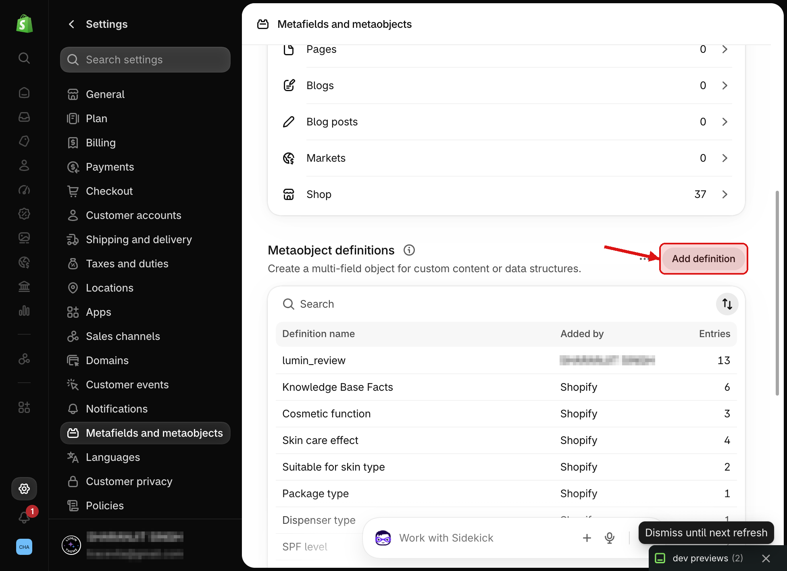
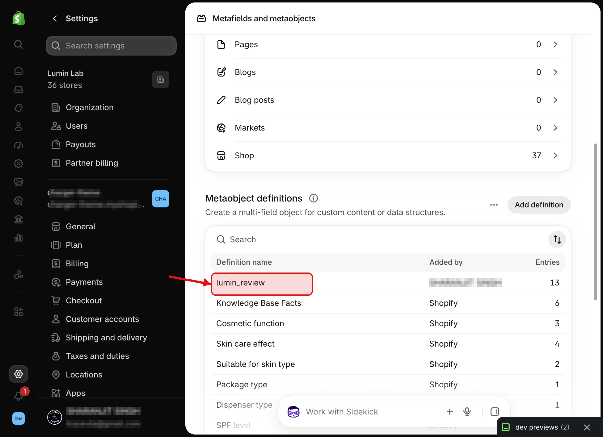
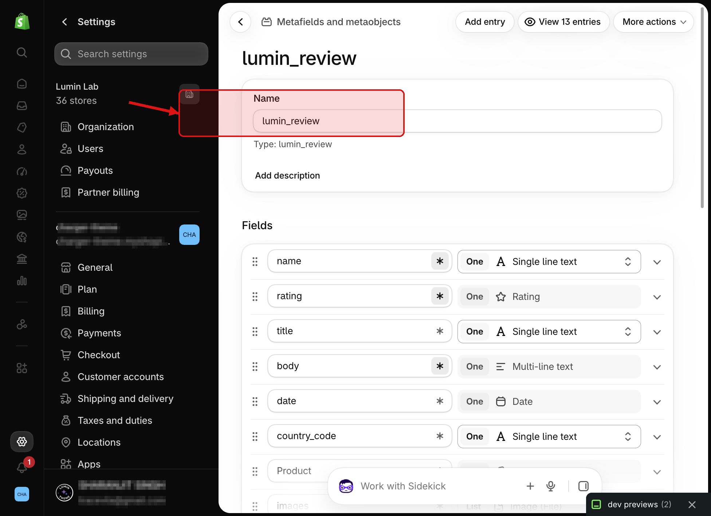
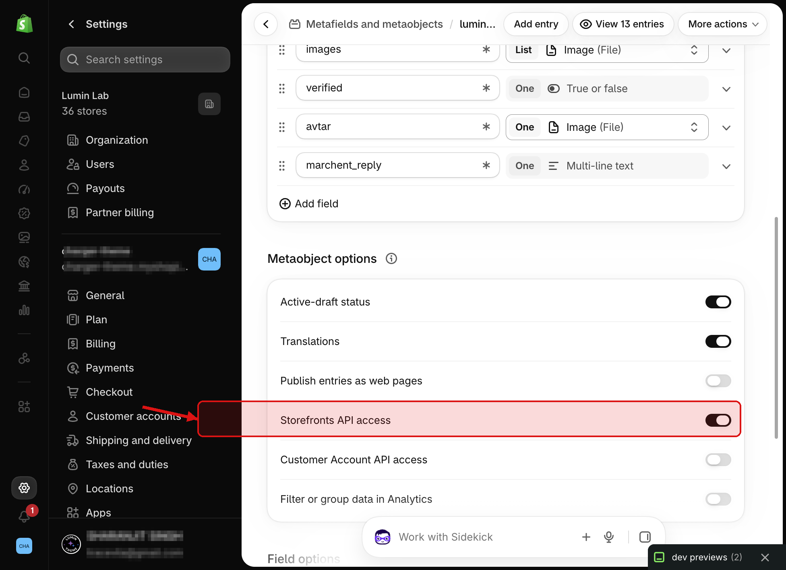
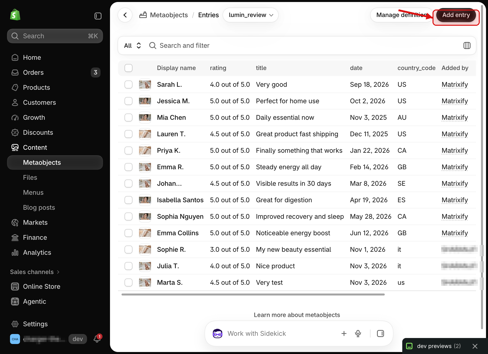
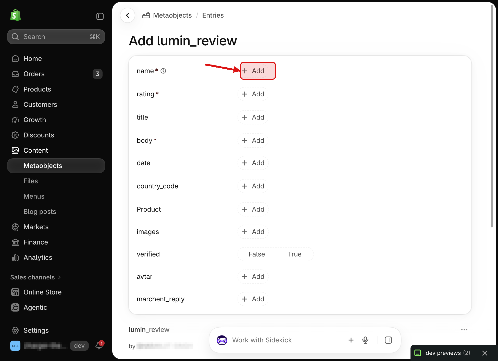
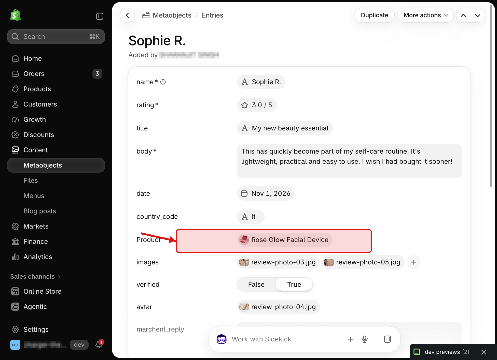

# How to set up Lumin Meta Reviews

Use a merchant `lumin_review` metaobject and the **Lumin Meta Reviews** theme section to show product reviews on your storefront—without the Lumin Kit app.

For app-synced reviews, see [Lumin Kit reviews](/guides/lumin-kit-reviews).

## Video

```html
<iframe
  src="https://www.loom.com/embed/VIDEO_ID"
  frameborder="0"
  allowFullScreen
  style="width: 100%; height: 400px; border-radius: 8px;"
></iframe>
```

## What you’ll create

1. A metaobject definition named `lumin_review` with the fields below.
2. Storefront access so the theme can read entries.
3. Review entries (manually or via CSV / Matrixify).
4. The **Lumin Meta Reviews** section on a product template.

Sample import rows ship with the theme as `lumin-review-metaobjects.csv`.

## 1. Open Metaobjects

In Shopify Admin go to **Content → Metaobjects**, or **Settings → Metafields and metaobjects**. Under **Metaobject definitions**, click **Add definition**.



*Settings → Metafields and metaobjects → Metaobject definitions → click **Add definition**.*



*After setup, open your definition by clicking **lumin_review** in the list.*

## 2. Create the `lumin_review` definition

Set the **Name** to something clear (for example “Lumin review”). The **Type** / handle must be exactly:

`lumin_review`

That handle is what the theme section looks up by default.

### Fields to add

Keep the **key** (API name) exact—including the spellings `avtar` and `marchent_reply` if you match the live definition used with LuminOS.

| Key | Type | Required? | Notes |
| --- | --- | --- | --- |
| `name` | Single line text | Yes | Reviewer display name. |
| `rating` | Rating | Yes | Scale 0–5 (or 1–5). Stored as rating JSON. |
| `title` | Single line text | No | Short headline. |
| `body` | Multi-line text | Yes | Full review text. |
| `date` | Date | No | Review date shown on the storefront. |
| `country_code` | Single line text | No | ISO code like `US`, `GB`, `IT`. |
| `product` | Product reference | No* | Link the review to a product. |
| `images` | File (list) / image list | No | Customer photos. |
| `verified` | True or false | No | Shows a verified badge when true. |
| `avtar` | File | No | Reviewer avatar image. |
| `marchent_reply` | Multi-line text | No | Store reply under the review. |

\*Recommended: always set `product` so reviews only appear on the right product page.



*Set the definition handle to `lumin_review`, then add the fields from the table.*

## 3. Turn on storefront access

Open the definition → **Metaobject options** (or Access). Enable storefront access so Liquid can read entries:

- **Storefronts API access**: On (Read)

<Warning>
Without storefront read access, the section will look empty even when entries exist in Admin.
</Warning>



*Turn on **Storefronts API access**, then save.*

## 4. Add review entries

From **Content → Metaobjects**, open `lumin_review` → click **Add entry**.



### Fill in a review

1. Enter **name**, **rating**, and **body** (required).
2. Optionally set title, date, and country code (e.g. `US`).
3. Select the **Product** this review belongs to.
4. Upload **images** and optional **avtar**.
5. Set **verified** to True if it was a verified purchase.
6. Add a **marchent_reply** if you want a store response.
7. Save.





*Link the review to a **Product**. Also add images, avatar, and set verified when needed.*

## 5. Bulk import with Matrixify (optional)

For many reviews, use Matrixify with a Metaobjects CSV. File name should include `metaobjects`.

- Columns typically include Handle, Command, Status, Definition: Handle, and Field / Value pairs.
- **Definition: Handle** = `lumin_review`
- **rating** must be JSON, for example:

```json
{"scale_min":"1.0","scale_max":"5.0","value":"5.0"}
```

Do not use a plain number like `5.0`.

- **product** should reference the product handle in the format Matrixify expects for product references.

Demo / trial Matrixify plans may limit how many rows you can import per run.

## 6. Add the theme section

1. Online Store → Themes → Customize.
2. Open a product template.
3. Add section **Lumin Meta Reviews**.
4. Confirm Metaobject type is `lumin_review` (default).
5. Choose section width and layout options, then save.

The section loads entries from `shop.metaobjects.lumin_review`, filters by the current product, and supports filter / sort / pagination in the browser. Write-a-review uses Shopify’s contact form email—publish new reviews by creating metaobject entries.

## Quick checklist

- Definition handle is `lumin_review`
- Field keys match the table above
- Storefront read access is on
- Entries link to the correct product
- Lumin Meta Reviews section is on the product template

## Still stuck?

Post in [Setup help](https://community.lumintheme.com/c/setup-help) with screenshots of the metaobject definition and product template.
